# Safe terminal approach to a tumbling, non-cooperative target

[](https://github.com/Hushbee5/tumbling-target-capture/actions/workflows/tests.yml)

Code and results for my IAC 2026 paper:

> H. B. Gürbüz, *Robust Autonomous Capture of Non-Cooperative Tumbling Targets: An Adaptive Control Barrier
> Function-Based Model Predictive Control Approach with Formal Safety Guarantees*, 77th International
> Astronautical Congress (IAC 2026), Antalya, Türkiye, paper IAC-26-A6.IP.162.

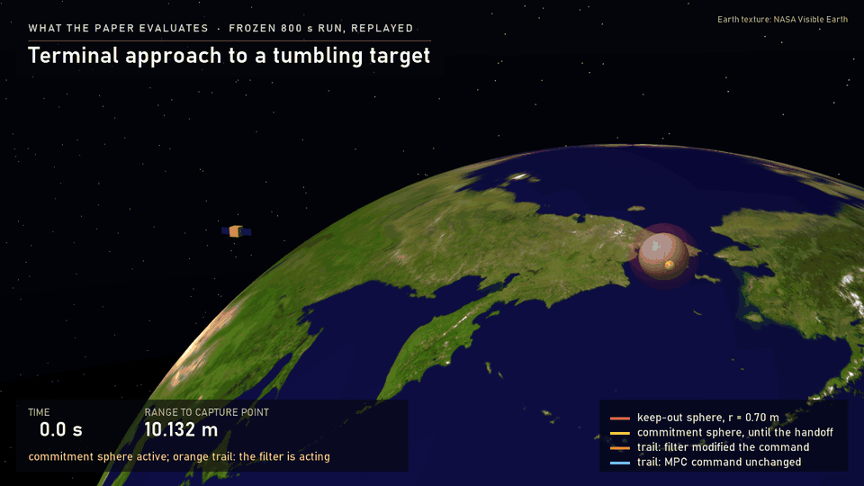

## The problem

A servicer has to reach a handle on a tumbling satellite. The handle moves with the target, it sits only about
10 cm outside a 0.70 m keep-out sphere, and the target's inertia is not known exactly.

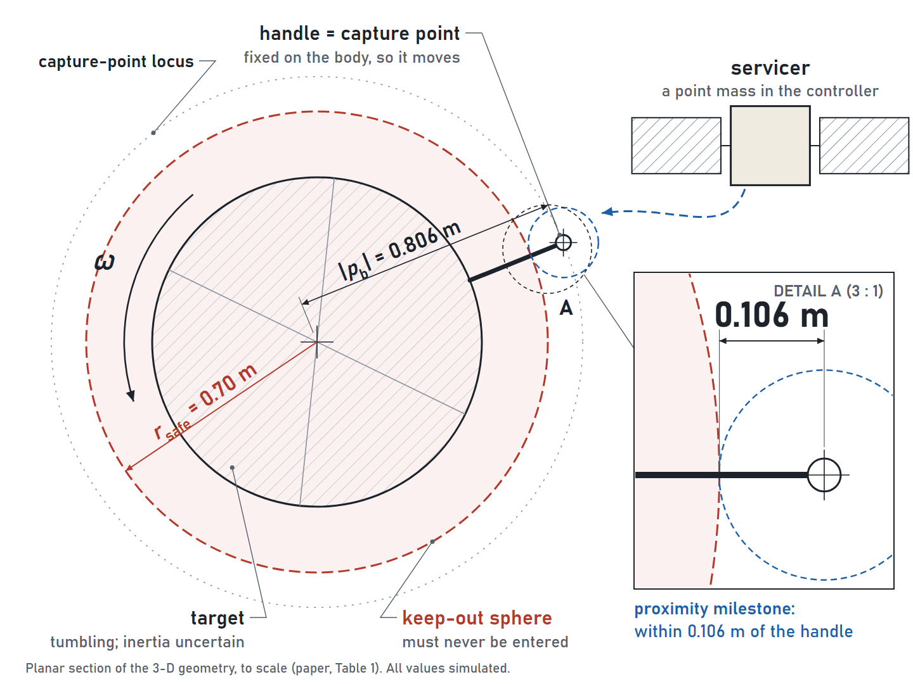

## The controller

- **Upper layer:** a preview-based linear MPC on Clohessy–Wiltshire dynamics, re-solved every 0.1 s over a 10 s
  horizon.
- **Lower layer:** a high-order control barrier function (HOCBF) quadratic program. It keeps the servicer out of the
  keep-out sphere and holds a commitment distance to the handle until a handoff.
- **Estimator:** an online estimator of the target's scale-free inertia ratios feeds the commitment constraint.

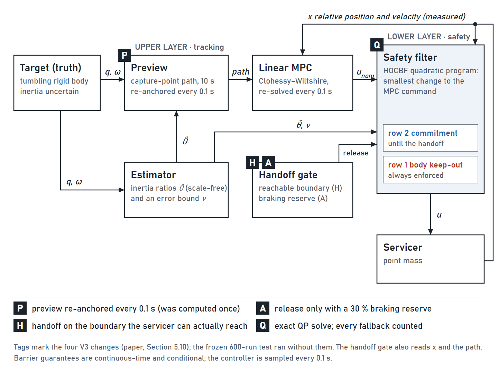

## Formulation

**Relative motion.** Clohessy–Wiltshire equations in the target-centred LVLH frame, with mean motion $n$ and
commanded acceleration $u$:

$$
\ddot r_x = 3n^2 r_x + 2n\dot r_y + u_x,\qquad
\ddot r_y = -2n\dot r_x + u_y,\qquad
\ddot r_z = -n^2 r_z + u_z,\qquad |u_i| \le u_{\max}.
$$

**Tumbling target.** Torque-free rigid-body rotation:

$$
I\dot\omega + \omega\times(I\omega) = 0,\qquad \dot q = \tfrac12\thinspace \Omega(\omega)\thinspace q .
$$

The capture point $p_b$ is fixed in the body frame, so in LVLH it moves as $p_{cp,L} = R(q_L)\thinspace p_b$.

**Upper layer: preview MPC.** Re-solved every $T_s = 0.1$ s over $N = 100$ steps, tracking the predicted
capture-point path:

$$
\min_{u}\mkern5mu \sum_{j}\thinspace (x[j]-x_{\mathrm{ref}}[j])^{\top}Q\thinspace (x[j]-x_{\mathrm{ref}}[j]) + u[j]^{\top}R\thinspace u[j]
\quad\text{s.t. discretised dynamics},\ |u_i|\le u_{\max}.
$$

**Lower layer: high-order CBF safety filter.** The keep-out barrier has relative degree two:

$$
h(x) = \lVert r\rVert^2 - r_{\mathrm{safe}}^2,\qquad
\psi_1 = \dot h + k_1 h,\qquad
\psi_2 = \dot\psi_1 + k_2\psi_1 \ge 0 .
$$

The applied command is the minimum-intervention correction of the MPC command:

$$
u_{\mathrm{safe}} = \arg\min_{u}\ \lVert u - u_{\mathrm{MPC}}\rVert^2
\quad\text{s.t.}\quad \psi_2(x,u)\ge 0,\ \ \text{capture row},\ \ |u_i|\le u_{\max}.
$$

**Adaptive capture-commitment row.** With the offset $d = r - p_{cp,L}$, the commitment barrier is

$$
h_{\mathrm{cap}} = d^{\top}d - s_{\mathrm{cap}}^2 .
$$

It is enforced robustly against the error of the estimated inertia ratios $\hat\theta$:

$$
\psi_{2,\mathrm{cap}}(x,\hat\theta) - \nu(t)\thinspace \lVert L_Y\psi_{1,\mathrm{cap}}\rVert \ge 0,
\qquad
\nu(t) = \sqrt3\thinspace \exp\negthinspace \Big(-\gamma\negthinspace \int_0^t\lambda_{\min}(\tau)\thinspace d\tau\Big).
$$

**Handoff (V3).** The commitment row is released on the reachable boundary, with a braking reserve
$\beta = 0.3$:

$$
h_{\mathrm{cap}} \le h^{*} + \varepsilon_h,\quad \dot\rho \le 0,\qquad
h^{*} = \frac{\eta\thinspace \nu}{\kappa_1\kappa_2},\qquad
a_{\mathrm{req}} \le (1-\beta)\thinspace u_{\max}.
$$

Here $\rho = \lVert d\rVert$ is the distance to the capture point.

**Geometry.** $r_{\mathrm{safe}} = 0.70$ m, $\lVert p_b\rVert = 0.806$ m, $s_{\mathrm{cap}} = 0.106$ m.

**Parameter-error bound (lemma).** The integrated regressor update is decoupled, so every component decays at
least as fast as the slowest mode:

$$
\tilde\theta_i(t) = \tilde\theta_i(0)\thinspace e^{-\gamma\int_0^t\lambda_i\thinspace d\tau}
\mkern5mu \Rightarrow\mkern5mu 
\lVert\tilde\theta(t)\rVert \le \lVert\tilde\theta(0)\rVert\thinspace e^{-\gamma\int_0^t\lambda_{\min}\thinspace d\tau}.
$$

With the truth-independent start $\hat\theta_0 = 0$ and $\lVert\theta\rVert\le\sqrt3$ on the admissible set
$\Theta=[-1,1]^3$, this gives $\nu(0)=\sqrt3$.

**Scope of the guarantee.** For the linear-gain chain, $\psi_2 \ge 0$ for all $t$ together with
$h(x_0)\ge 0$ and $\psi_1(x_0)\ge 0$ implies $h(x(t))\ge 0$ for all $t$. This is a continuous-time statement; the
implementation enforces it at the 0.1 s samples, and every safety quantity is also checked on a finer
intersample grid.

## Key numbers from the paper

**Model verification (selected).**

| Check | Recorded |
|---|---|
| Quaternion norm error (120 s) | 2.22×10⁻¹⁶ |
| Relative angular-momentum drift | 8.51×10⁻¹¹ |
| Linear vs. nonlinear relative dynamics, 120 s | 2.045×10⁻⁷ m |
| Capture-point radius invariance | 4.13×10⁻¹⁶ |

**Deterministic 800 s scenario** (identical scenario, actuator model and metric code for all three controllers).

| Quantity | Proposed | Nominal MPC | APF |
|---|---|---|---|
| Proximity milestone time [s] | 626.3 | 191.8 | 217.5 |
| Δv over the full 800 s [m/s] | **2.347** | 2.434 | 2.447 |
| Minimum clearance [m] | 0.0633 | 0.0900 | 0.0920 |
| Body violations (80 001 inspected points) | none | none | none |
| QP failures / steps at the actuator box | 0 / 0 of 8000 | — | — |

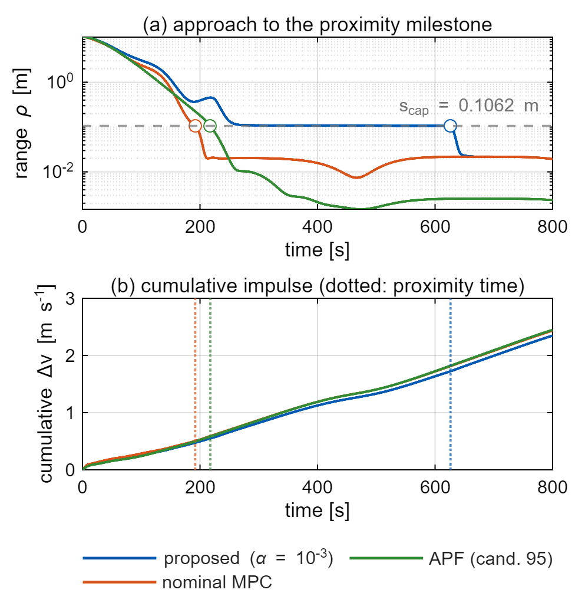

The uncertainty bound carried by the commitment row decays from √3 to 1.23×10⁻³ during the run. The filter
modifies the nominal command on 6035 of 8000 steps.

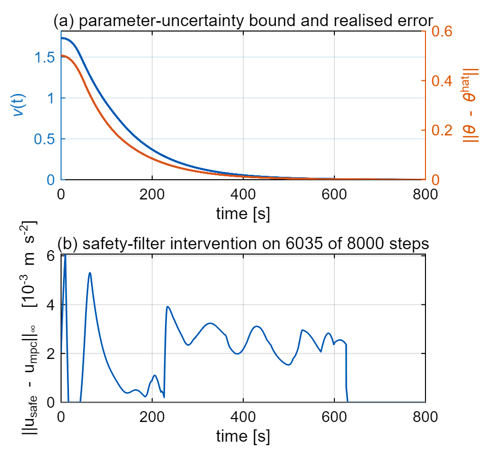

**Sampled-data finding.** At the tightest detector setting, the first chain function of the commitment row is
negative on 43 enforced samples while the barrier itself stays positive. This is a measured instance of the gap
between the continuous-time argument and the sampled implementation.

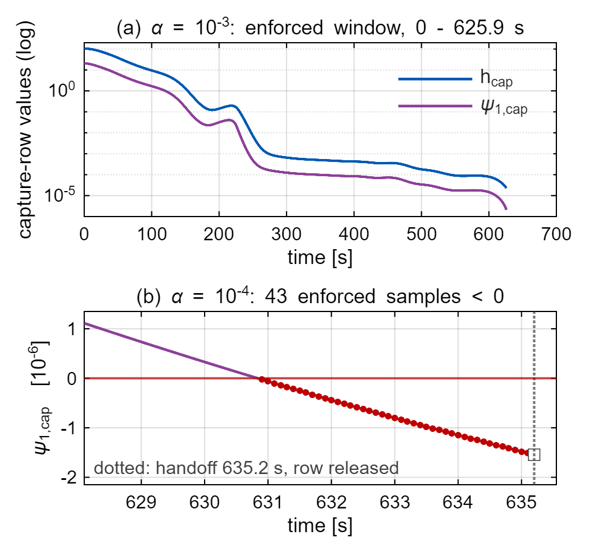

## Results (simulation)

**600-run predeclared Monte Carlo stress test.**
- 100 random trials × 2 preview conditions × 3 controllers (proposed, nominal MPC, artificial potential field).
- The protocol was frozen before the trial table was drawn.

| Outcome (out of 100 trials) | Proposed U | Proposed M | Nominal MPC U | Nominal MPC M | APF U | APF M |
|---|---|---|---|---|---|---|
| No observed body violation | **100** | **100** | 70 | 69 | 83 | 87 |
| Proximity milestone | 1 | 12 | 32 | 69 | 29 | 87 |

- **U:** the preview uses the nominal inertia (the realistic, mismatched case).
- **M:** the preview uses the true inertia (a reference).
- **Diagnosis:** the analysis traced the low arrival rate to the open-loop preview, which drifts under inertia
  mismatch (median maximum error 0.71 m), and to a handoff band that the tightened commitment row did not let the
  servicer enter. Version V3 corrects both.

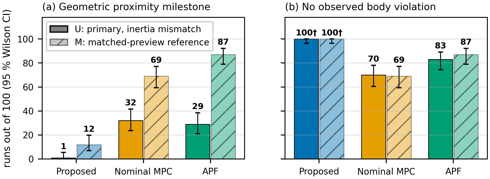
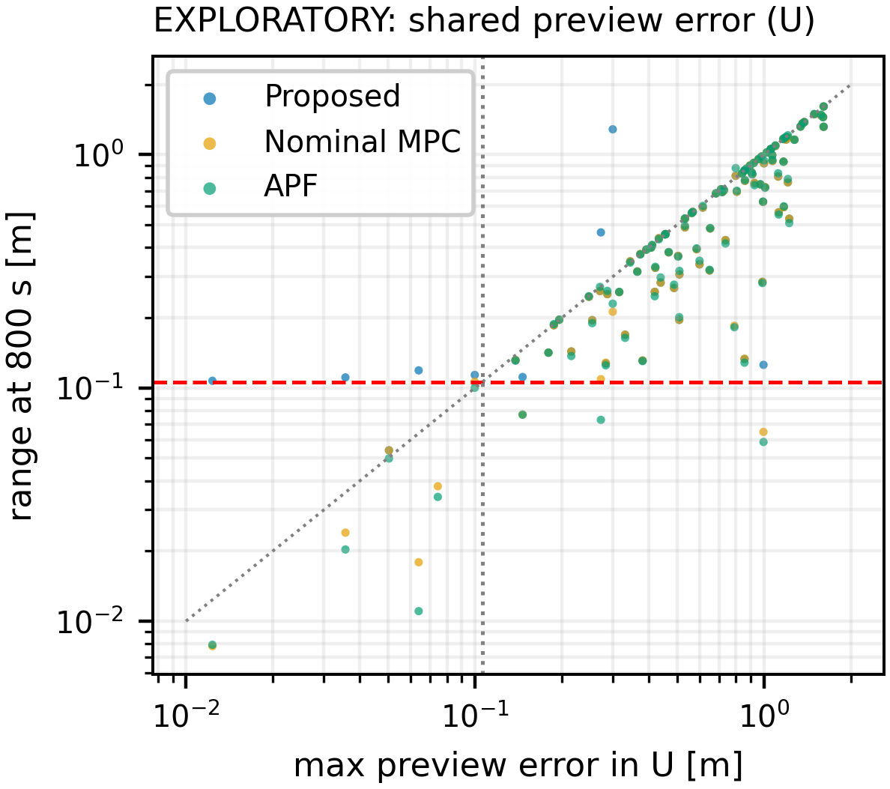

**Validation of the improved version (V3).**
- 60 new trials, protocol frozen in advance, all controllers given the same online preview.
- V3 had no observed keep-out violation in 60 of 60 runs and reached the capture zone in 57 of 60.
- The nominal MPC entered the keep-out sphere in 15 runs and the APF in 8.

| Quantity (60 new trials, same preview for all) | V3 | Nominal MPC | APF |
|---|---|---|---|
| No observed body violation | **60** | 45 | 52 |
| Proximity milestone | **57** | 45 | 52 |
| Guard breaches / QP fallbacks | 0 / 0 | — | — |
| Minimum clearance over all runs [m] | **+0.00015** | −0.494 | −0.122 |

Both predeclared criteria were met: at least 59/60 runs without violation, and at least 18/60 runs reaching the
milestone.

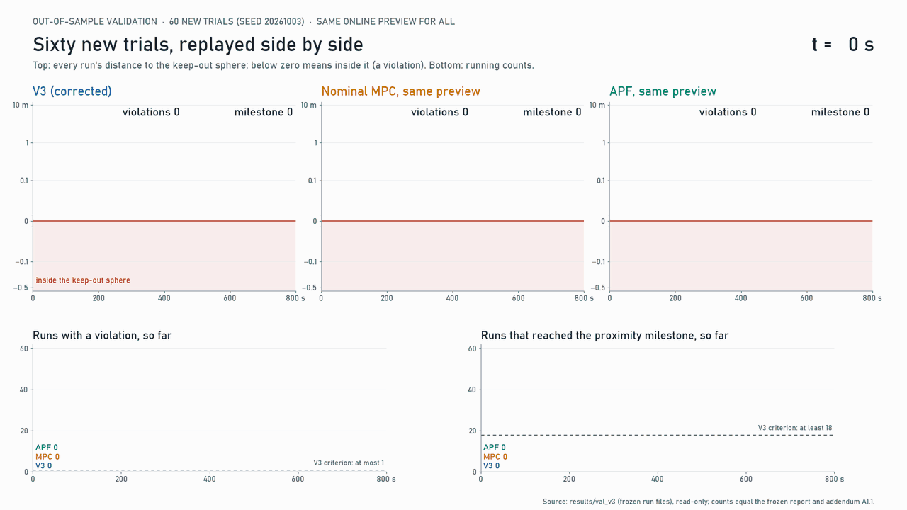
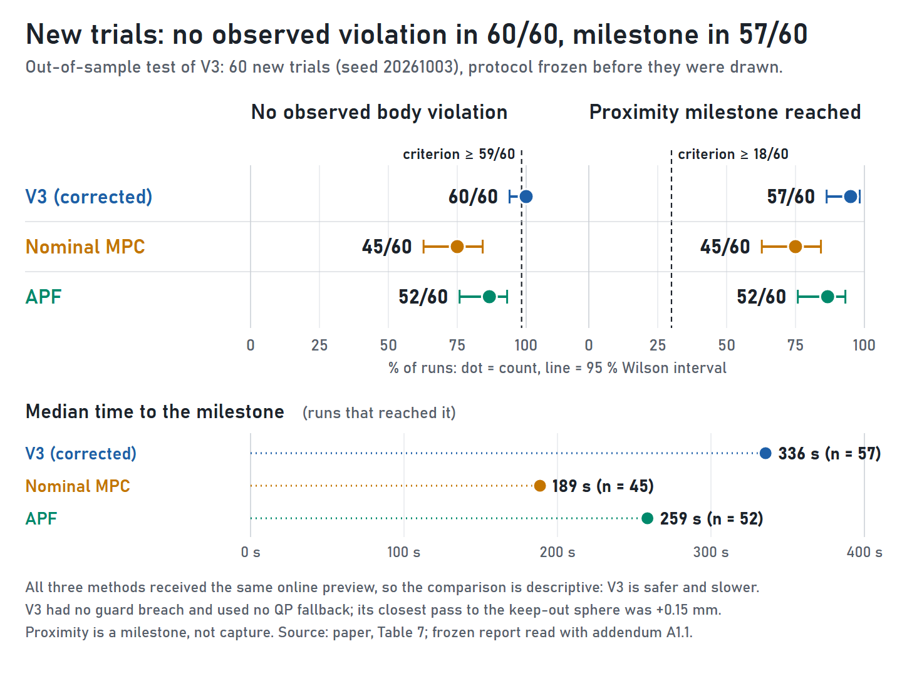

**Beyond the paper (development prototypes):**
- a 6-DOF arm on a free-floating bus grasping the handle in MuJoCo;
- a two-process ROS 2 lockstep co-simulation;
- a real-time-iteration nonlinear MPC.

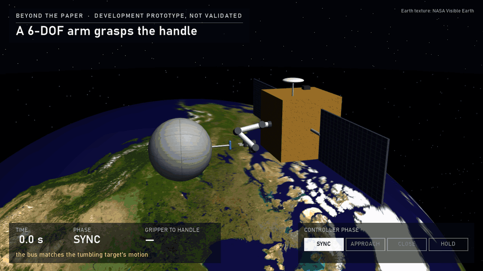

## Python port of the controller

`python/gnc` is a Python port of the controller core: the Clohessy–Wiltshire model, the condensed preview MPC
(solved with OSQP and refined to the exact solution on the active set) and the HOCBF-QP safety filter. It is checked
against outputs recorded from the MATLAB implementation (`tests/python/test_gnc_parity.py`):

| Check against MATLAB | Largest difference |
|---|---|
| Safety filter, 300 random states and commands (70 with the safety row active) | 3×10⁻¹⁸ m/s² |
| MPC input sequence, 20 random states and set points | 9×10⁻¹³ m/s² |
| 200 s closed loop, MPC → filter → plant, 2000 steps (with / without the filter) | 5×10⁻¹³ m / 2×10⁻¹² m |

In the demo below the set point lies behind the target. The MPC alone flies through the keep-out sphere. With the
filter, the servicer slows down at the sphere, slides around it and reaches the set point without entering it.

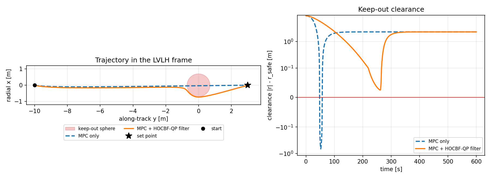

**MuJoCo plant.** `python/gnc/mujoco_loop.py` lets the same controller fly a 100 kg free body in MuJoCo. The
Clohessy–Wiltshire terms and the command enter through MuJoCo's passive-force callback, so they are re-evaluated at
every RK4 stage. Over 200 s (2000 control steps) the MuJoCo loop reproduces the exact-ZOH loop to 3×10⁻¹⁴ m, and the
keep-out clearance is also checked at every 10 ms physics step.

Building this loop exposed one robustness issue in the safety filter, now fixed in the port. MuJoCo leaves values such
as 10⁻⁷⁴ in an axis that should be exactly zero, and the bisection bracket of the filter's dual was computed from all
components, which pushed it to about 10⁷², beyond what its fixed 200 bisection steps can resolve. The bracket is now
computed from the significant components only (`test_filter_bracket_with_vanishing_component`). The MATLAB filter
uses the same bracket; the issue arises only for such vanishingly small, non-zero components.

The port covers the controller core with a fixed set point. The capture-point preview of the tumbling target, the
inertia estimator and the commitment row of the paper remain in the MATLAB code.

## Repository layout

| Folder | Contents |
|---|---|
| `matlab/core` | dynamics, MPC, HOCBF filter, estimator, baselines, Monte Carlo campaign and verification code |
| `matlab/v3` | the improved architecture used in the 60-trial validation; kept separate so that the code of the 600-run campaign stays exactly as it was frozen |
| `python/gnc` | Python port of the controller core (CW model, MPC, HOCBF-QP filter), closed-loop demo, MuJoCo plant |
| `python/mujoco_capture` | MuJoCo model of the bus, arm and target; capture controller; stress tests |
| `python/ros2_capture` | ROS 2 plant and controller nodes |
| `python/rendering` | renders, animations and the figures above |
| `python/analysis` | validation report and analysis scripts |
| `protocols` | predeclared test protocols and the validation trial table |
| `results` | summary results (CSV, JSON, reports); raw run records are not included because of their size |
| `figures`, `media` | figures and animations |
| `tests` | automated checks: MATLAB verification suites, Python-MATLAB parity of the port, MuJoCo model checks |
| `scripts` | asset setup for the renders |

**Tools used:** MATLAB (R2025b with the Optimization, Control System and Model Predictive Control toolboxes), Python 3.10 with NumPy/SciPy, OSQP and MuJoCo, ROS 2 Humble.

## Getting started

```bash
git clone https://github.com/Hushbee5/tumbling-target-capture.git
cd tumbling-target-capture
pip install -r requirements.txt
pytest                              # Python-MATLAB parity of the port, MuJoCo model checks M1-M5
python python/gnc/demo.py demo.png  # closed-loop demo of the Python port
python scripts/setup_assets.py      # only for the renders: NASA Earth texture and sphere mesh
```

In MATLAB, from the repository root:

```matlab
results = runtests('tests/matlab')  % verification suites of the dynamics, the safety filter and the MPC
```

Both test sets also run automatically on every push (GitHub Actions).

## Notes

- All results are from simulation.
- Known issue in the MuJoCo prototype: the Clohessy-Wiltshire forces are applied once per step, so the orbital
  terms are integrated to first order (7.4e-7 m error after 600 s). Check M6 records this as an expected failure
  (`pytest -m slow`).
- Raw `.mat` run records (several hundred MB) are available on request.
- The Earth texture in the renders is NASA Visible Earth imagery (Blue Marble). It is not included here;
  `scripts/setup_assets.py` downloads it from NASA Visible Earth and converts it.
- The paper itself is not included (IAF copyright).

© 2026 Hasan Baran Gürbüz. All rights reserved.
